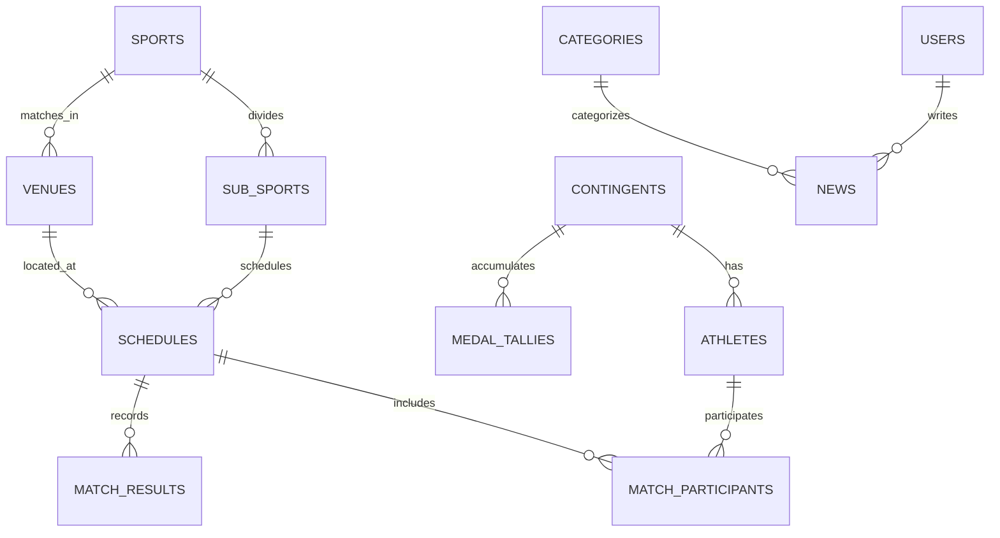

# 📋 IMPLEMENTATION PLANNING: PORTAL PEKAN OLAHRAGA PROVINSI (PORPROV) SUMATERA BARAT 2026

**Dokumen Versi:** 1.0.0  
**Tanggal:** 17 Oktober 2026  
**Status:** Draf Perencanaan Teknis & Arsitektur  
**File Name:** `planning_porprov1.md`

---

## 1. Ringkasan Eksekutif & Visi Proyek

Portal Resmi **Pekan Olahraga Provinsi (PORPROV) Sumatera Barat 2026** dirancang sebagai sistem informasi digital terpadu yang menyajikan seluruh informasi kompetisi multi-event olahraga tingkat provinsi Sumbar secara cepat, akurat, modern, dan andal.

### 🎯 Tujuan Utama
1. **Pusat Informasi Terintegrasi:** Menyajikan berita atlet, liputan cabang olahraga, jadwal dan hasil pertandingan, serta perolehan medali secara *real-time*.
2. **Kinerja & Kecepatan Ekstrem:** Mengombinasikan Next.js untuk antarmuka publik yang instan (SSR/ISR) dengan Express.js untuk REST API berkecepatan tinggi.
3. **Pengelolaan Data Terstruktur:** Memanfaatkan Laravel 11 (Blade) sebagai Admin Panel yang kokoh, stabil, dan ramah admin dalam memanipulasi data multi-cabor dan kontingen 19 Kabupaten/Kota.
4. **Portabilitas & Skalabilitas:** Menggunakan container Docker terisolasi untuk menjamin kemudahan *deployment*, stabilitas lingkungan server, dan keselarasan antar dev/prod.
5. **Keamanan Data:** Standar autentikasi token berbasis JSON Web Token (JWT) yang aman untuk menjamin integritas pertukaran data antar-layanan.

---

## 2. Arsitektur Sistem & Spesifikasi Teknologi

Sistem mengadopsi arsitektur **Hybrid Multi-Service Container** berbasis Docker:

```mermaid
graph TD
    User([Pengunjung / Publik]) -->|HTTP/HTTPS Port 80/443| NginxProxy[Nginx Reverse Proxy / Gateway]
    Admin([Panitia / Admin Porprov]) -->|HTTP/HTTPS Port 80/443| NginxProxy

    subgraph Docker Environment
        NginxProxy -->|/admin & /storage| LaravelApp[Admin Panel: Laravel 11 Blade + PHP 8.2-FPM]
        NginxProxy -->|/api| ExpressAPI[REST API Engine: Express.js Node 20]
        NginxProxy -->|/ (Default)| NextApp[Public Portal: Next.js 14/15 App Router]

        ExpressAPI -->|Query / Mutasi| MySQL[(Database: MySQL 8.0)]
        LaravelApp -->|CRUD, Migrations, Seeders| MySQL
        ExpressAPI -->|Cache Leaderboard / Medal Tally| Redis[(In-Memory Cache: Redis 7)]
    end

    LaravelApp -.->|JWT Auth & Token Verification| ExpressAPI
    NextApp -.->|Fetch Data via JWT Bearer| ExpressAPI
```

### ⚙️ Detail Komponen Teknologi

| Komponen | Teknologi | Peran & Tanggung Jawab |
| :--- | :--- | :--- |
| **Container Engine** | **Docker & Docker Compose** | Mengisolasi runtime seluruh micro-service (PHP, Node, MySQL, Redis, Nginx). |
| **Admin Panel** | **Laravel 11 (Blade)** | Backend internal admin, manajemen hak akses, kelola data master cabor, wasit, atlet, kontingen, input skor/medali resmi, media upload. |
| **REST API Server** | **Express.js (Node.js)** | Menyajikan API endpoints publik berkecepatan tinggi, kompresi respons, validasi request, dan verifikasi JWT. |
| **Public Portal** | **Next.js (App Router)** | Antarmuka pengguna (UI/UX) publik responsif dengan Server-Side Rendering (SSR) dan Incremental Static Regeneration (ISR) untuk SEO dan performa tinggi. |
| **Database** | **MySQL 8.0** | RDBMS terpusat untuk integritas relasi antar-entitas kompetisi, kontingen, medali, dan berita. |
| **Caching Layer** | **Redis 7** | Cache query klasemen medali, jadwal tanding hari ini, dan berita trending agar tidak membebani MySQL saat lonjakan *traffic*. |
| **Keamanan Data** | **JWT (JSON Web Token)** | Mengamankan transmisi endpoint sensitif, pertukaran payload data antar platform, dan otentikasi API client. |

---

## 3. Fitur Utama & Fitur Unggulan Menarik

Selain kebutuhan dasar berita dan ranking medali, portal dilengkapi fitur modern untuk menyemarakkan PORPROV Sumbar 2026:

### A. Fitur Publik Utama
1. **Ranking & Klasemen Medali Real-time (Medal Tally Standings):**
   - Urutan klasemen perolehan Emas, Perak, Perunggu, dan Total Medali dari 19 Kabupaten/Kota di Sumatera Barat.
   - Filter medali berdasarkan Cabang Olahraga (Cabor), tanggal pertandingan, dan pencarian kontingen.
   - Indikator perubahan posisi kontingen (naik/turun ranking) secara dinamis.
2. **Kanal Berita Atlet & Liputan Event:**
   - Wawancara eksklusif atlet berprestasi, profil perjalanan atlet muda berbakat Ranah Minang.
   - Kategori berita: Berita Utama, Sorotan Cabor, Human Interest, Galeri Aksi, dan Rangkuman Harian.
3. **Jadwal & Hasil Pertandingan Interaktif (Match Center):**
   - Kalender pertandingan harian yang dapat difilter berdasarkan Cabor, Hari/Tanggal, dan Lokasi Venue.
   - Bagan turnamen (Bagan Eliminasi / Bracket Knockout & Round-Robin Klasemen Grup) otomatis.
   - Status live: *Scheduled*, *Ongoing/Live*, *Completed*, *Postponed*.

### B. Fitur Tambahan Menarik (Value-Added Features)
4. **Peta Interaktif Venue Pertandingan (Interactive Venue GIS):**
   - Peta digital interaktif lokasi *venue* pertandingan di wilayah Sumatera Barat (Google Maps / Leaflet integration).
   - Menampilkan titik koordinat gedung olahraga, cabor yang dipertandingkan di venue tersebut, rute navigasi, dan kapasitas penonton.
5. **Profil 19 Kontingen Kabupaten/Kota Se-Sumbar:**
   - Halaman khusus masing-masing daerah (Kota Padang, Bukittinggi, Kab. Agam, Tanah Datar, Solok, Pasaman, Kep. Mentawai, dll.).
   - Menampilkan daftar atlet kontingen, cabor yang diikuti, target medali, serta sejarah prestasi daerah.
6. **Hall of Fame & Rekor Porprov (Record Breakers):**
   - Menampilkan catatan rekor Porprov baru yang terpecahkan pada cabang terukur (Atletik, Renang, Angkat Besi, Selam, Menembak).
7. **Pusat Unduhan & Regulasi (Official Download Center):**
   - Unduh buku panduan teknis (*Technical Handbook* / THB per Cabor).
   - Unduh hasil resmi pertandingan dalam format PDF yang telah diverifikasi oleh dewan juri/panpel.
8. **Supporter Zone & Polling Atlet Favorit:**
   - Dinding dukungan (*cheering wall*) bagi masyarakat untuk mengirimkan pesan semangat kepada kontingen daerah masing-masing.
   - Polling digital atlet terfavorit Porprov 2026 dengan proteksi reCAPTCHA dan rate limiting.
9. **Media & Streaming Hub:**
   - Integrasi tayangan siaran langsung (Live YouTube/Facebook Video stream panitia) untuk partai final cabor bergengsi (Sepak Bola, Silat, Bulutangkis, dll.).

---

## 4. Desain Basis Data (Database Schema)

Skema database dirancang ternormalisasi pada MySQL 8.0 dengan indeks teroptimasi:



### Ringkasan Entitas & Atribut Penting
1. `contingents`: `id`, `name` (e.g. "Kota Padang", "Kab. Tanah Datar"), `code`, `logo_url`, `color_hex`, `official_count`.
2. `sports`: `id`, `name` (e.g. "Pencak Silat", "Sepak Takraw"), `slug`, `icon_url`, `description`.
3. `sub_sports` (Nomor Pertandingan): `id`, `sport_id`, `name` (e.g. "Kelas 50-55kg Putra"), `gender_category` (Putra, Putri, Campuran).
4. `venues`: `id`, `name`, `city`, `address`, `latitude`, `longitude`, `capacity`, `google_map_url`.
5. `athletes`: `id`, `contingent_id`, `sport_id`, `nik`, `full_name`, `gender`, `birth_date`, `photo_url`, `is_verified`.
6. `schedules`: `id`, `sub_sport_id`, `venue_id`, `round_name`, `start_time`, `end_time`, `status` (*upcoming, live, completed, canceled*).
7. `match_results`: `id`, `schedule_id`, `winner_athlete_contingent_id`, `score_detail` (JSON data format), `verified_by`, `verified_at`.
8. `medal_tallies`: `id`, `contingent_id`, `gold_count`, `silver_count`, `bronze_count`, `rank_position`, `last_updated`.
9. `news`: `id`, `title`, `slug`, `category_id`, `author_id`, `thumbnail_url`, `content`, `views_count`, `published_at`, `status`.
10. `records`: `id`, `sub_sport_id`, `athlete_id`, `contingent_id`, `record_metric`, `previous_record`, `new_record`, `achieved_date`.

---

## 5. Alur Autentikasi & Keamanan JWT

### Alur Kerja (Workflow)
1. **Autentikasi Internal Admin:**
   - Admin login melalui Admin Panel Laravel 11.
   - Laravel memvalidasi kredensial dan menerbitkan Session untuk admin browser.
   - Untuk komunikasi headless atau integrasi API, Laravel Auth / Express Auth menerbitkan **JWT Access Token** (masa aktif 15-60 menit) dan **Refresh Token** (masa aktif 7 hari).
2. **Pertukaran Data Client-to-API:**
   - Portal publik Next.js melakukan request data publik secara terbuka (GET `/api/v1/medals`, `/api/v1/news`, `/api/v1/schedules`).
   - Endpoint terproteksi (mutasi skor, upload berita, pembaruan data atlet) wajib menyertakan header:
     ```http
     Authorization: Bearer <JWT_ACCESS_TOKEN>
     ```
3. **Validasi JWT di Express.js:**
   - Middleware `jwtAuthMiddleware` memvalidasi signature menggunakan shared secret `JWT_SECRET` atau public key RSA (RS256).
   - Mengekstrak payload: `user_id`, `role` (*superadmin, cabor_admin, reporter*), `permissions`.
   - Mengembalikan response `401 Unauthorized` atau `403 Forbidden` jika token expired/invalid.

---

## 6. Struktur Direktori Proyek (Project Structure)

Proyek dikelola dalam struktur modular terpusat (*docker-orchestrated workspace*):

```text
PORPROV-2026/
├── docker-compose.yml              # Definisi multi-container orchestration
├── .env.example                    # Global environment configurations
├── planning_porprov1.md            # Dokumen perencanaan ini
│
├── admin/                          # [Laravel 11] Admin Panel & Master Data Management
│   ├── app/
│   │   ├── Http/Controllers/Admin/
│   │   ├── Models/
│   │   └── Services/
│   ├── database/migrations/
│   ├── database/seeders/
│   ├── resources/views/admin/      # Blade layouts, components, CRUD views
│   ├── Dockerfile
│   └── composer.json
│
├── api/                            # [Express.js] High-Speed REST API Engine
│   ├── src/
│   │   ├── config/                 # DB pool, Redis client, JWT config
│   │   ├── controllers/            # Controller logic (medals, news, schedules)
│   │   ├── middlewares/            # JWT auth, rate limiter, cache middleware
│   │   ├── routes/                 # Express routing modular
│   │   └── app.js
│   ├── Dockerfile
│   └── package.json
│
├── frontend/                       # [Next.js] Public Dynamic High-Performance Portal
│   ├── src/
│   │   ├── app/                    # Next.js App Router (berita, medali, venue, jadwal)
│   │   ├── components/             # Reusable UI components (MedalTable, NewsCard, Map)
│   │   ├── lib/api.js              # Fetcher client ke Express API & Laravel storage
│   │   └── styles/
│   ├── Dockerfile
│   └── package.json
│
└── docker/
    └── nginx/
        ├── default.conf            # Reverse proxy & routing config
        └── ssl/                    # Sertifikat SSL (Dev/Prod)
```

---

## 7. Rencana Konfigurasi Docker Compose

Konfigurasi `docker-compose.yml` mencakup 5 layanan utama:

```yaml
version: '3.8'

services:
  # 1. Reverse Proxy & Gateway
  nginx-proxy:
    image: nginx:alpine
    container_name: porprov_proxy
    ports:
      - "80:80"
      - "443:443"
    volumes:
      - ./docker/nginx/default.conf:/etc/nginx/conf.d/default.conf
      - ./admin/storage/app/public:/var/www/html/public/storage
    depends_on:
      - admin-app
      - api-app
      - frontend-app
    networks:
      - porprov_network

  # 2. Admin Panel (Laravel 11 + PHP 8.2-FPM)
  admin-app:
    build:
      context: ./admin
      dockerfile: Dockerfile
    container_name: porprov_admin
    restart: unless-stopped
    environment:
      DB_HOST: db-mysql
      DB_PORT: 3306
      DB_DATABASE: porprov2026
      DB_USERNAME: root
      DB_PASSWORD: ${DB_ROOT_PASSWORD}
    volumes:
      - ./admin:/var/www/html
    depends_on:
      - db-mysql
    networks:
      - porprov_network

  # 3. REST API Engine (Express.js Node.js 20)
  api-app:
    build:
      context: ./api
      dockerfile: Dockerfile
    container_name: porprov_api
    restart: unless-stopped
    environment:
      PORT: 5000
      DB_HOST: db-mysql
      DB_USER: root
      DB_PASS: ${DB_ROOT_PASSWORD}
      DB_NAME: porprov2026
      REDIS_HOST: cache-redis
      JWT_SECRET: ${JWT_SECRET}
    depends_on:
      - db-mysql
      - cache-redis
    networks:
      - porprov_network

  # 4. Frontend Publik (Next.js 14/15)
  frontend-app:
    build:
      context: ./frontend
      dockerfile: Dockerfile
    container_name: porprov_frontend
    restart: unless-stopped
    environment:
      NEXT_PUBLIC_API_URL: http://api-app:5000/api/v1
    depends_on:
      - api-app
    networks:
      - porprov_network

  # 5. Database MySQL 8.0
  db-mysql:
    image: mysql:8.0
    container_name: porprov_mysql
    restart: always
    environment:
      MYSQL_ROOT_PASSWORD: ${DB_ROOT_PASSWORD}
      MYSQL_DATABASE: porprov2026
    ports:
      - "3306:3306"
    volumes:
      - mysql_data:/var/lib/mysql
    networks:
      - porprov_network

  # 6. Redis Caching
  cache-redis:
    image: redis:7-alpine
    container_name: porprov_redis
    restart: always
    ports:
      - "6379:6379"
    volumes:
      - redis_data:/data
    networks:
      - porprov_network

networks:
  porprov_network:
    driver: bridge

volumes:
  mysql_data:
  redis_data:
```

---

## 8. Tahapan Implementasi (Roadmap & Milestones)

Implementasi dibagi menjadi **6 Fase Terstruktur**:

| Fase | Durasi Estimasi | Lingkup Pekerjaan | Target Luaran (Deliverables) |
| :--- | :--- | :--- | :--- |
| **Fase 1: Setup Lingkungan Docker & Fondasi Basis Data** | Minggu 1 | - Konfigurasi `docker-compose.yml`, Dockerfile Laravel, Express, Next.js, dan Nginx.<br>- Migrasi skema database utama MySQL menggunakan Laravel migration.<br>- Data Seeder untuk 19 Kabupaten/Kota Sumbar & daftar Cabor. | Seluruh container berjalan sehat (`docker compose up -d`), tabel database terbuat lengkap beserta relasi. |
| **Fase 2: REST API Engine & Keamanan JWT (Express.js)** | Minggu 2 | - Setup boilerplate Express.js, connection pool MySQL, dan Redis.<br>- Pembuatan generator & verifikator token JWT.<br>- Endpoint CRUD & query performa tinggi untuk Medali, Jadwal, Berita, Atlet, dan Venue.<br>- Integrasi caching Redis untuk leaderboard medali. | API terdokumentasi (Swagger/Postman), terproteksi JWT, respons rata-rata < 50ms. |
| **Fase 3: Admin Panel Laravel 11 (Blade)** | Minggu 3 | - Pembuatan dashboard admin dengan Blade + UI Admin responsif.<br>- Modul Manajemen Konten (CMS Berita, Kategori, Upload Media).<br>- Modul Manajemen Cabor, Nomor Lomba, Kontingen, & Data Atlet.<br>- Modul Input Hasil Pertandingan & Perolehan Medali otomatis. | Panitia pelaksana dapat mengelola seluruh data perlombaan dengan mudah dan aman. |
| **Fase 4: Antarmuka Web Utama (Next.js)** | Minggu 4 | - Desain UI modern dengan nuansa identitas olahraga Sumatera Barat (Marawa: Merah, Kuning, Hitam modern styling).<br>- Halaman Beranda (Hero Banner, Top 5 Medali, Berita Terkini, Jadwal Hari Ini).<br>- Halaman Klasemen Lengkap Medali (dengan tabel interaktif & download).<br>- Halaman Kanal Berita & Detail Wawancara Atlet.<br>- Halaman Interaktif Peta Venue & Jadwal Pertandingan. | Web publik Next.js super cepat, Google Lighthouse score > 90, SEO-ready. |
| **Fase 5: Fitur Interaktif Tambahan & Value-Added** | Minggu 5 | - Integrasi GIS Peta Venue Google Maps / OpenStreetMap.<br>- Modul Rekor Baru Porprov (Record Breakers).<br>- Supporter Zone & Polling Atlet Favorit.<br>- Integrasi Live Streaming Embed Player. | Fitur pelengkap interaktif siap pakai untuk memeriahkan event. |
| **Fase 6: Pengujian, Keamanan, & Deployment Server** | Minggu 6 | - Load testing / Stress testing (menghadapi lonjakan pembaca berita & cek medali).<br>- Audit keamanan (CORS, JWT revocation, SQL injection, XSS check).<br>- Konfigurasi Domain produksi, SSL Let's Encrypt, dan backup rutin database otomatis. | Sistem siap tayang (*Production Ready*) untuk menyukseskan PORPROV Sumbar 2026. |

---

## 9. Strategi Pengujian & Jaminan Kualitas (QA)

1. **Uji Kecepatan & Performa:**
   - Memastikan endpoint klasemen medali didukung Redis caching sehingga mampu melayani 5.000+ request per menit secara simultan tanpa menurunkan performa server.
   - Pemanfaatan Next.js ISR (*Incremental Static Regeneration*) dengan interval revalidasi 30 detik untuk halaman klasemen.
2. **Uji Keamanan:**
   - Validasi ketat token JWT pada setiap aksi sensitif (perubahan skor medali).
   - Sanitasi input form berita dan upload gambar di Laravel menggunakan validasi MIME-type ketat (hanya jpg, png, webp).
3. **Uji Responsivitas & Aksesibilitas:**
   - 100% responsif pada layar smartphone, tablet, dan desktop untuk memudahkan akses penonton dan ofisial langsung dari lokasi venue lapangan.

---

## 10. Kesimpulan & Langkah Selanjutnya

Rancangan arsitektur ini menggabungkan keunggulan terbaik dari masing-masing ekosistem:
- **Laravel 11 (Blade):** Efisiensi dan kenyamanan penuh dalam pembuatan panel admin yang terstruktur.
- **Express.js:** Kecepatan throughput tinggi untuk pertukaran data API dan verifikasi JWT.
- **Next.js:** Pengalaman visual terbaik bagi publik dengan kecepatan akses halaman maksimal dan dukungan SEO prima.
- **Docker:** Konsistensi deployment multi-layanan dalam satu kesatuan infrastruktur.

Langkah berikutnya adalah memulai **Fase 1: Inisialisasi arsitektur multi-container Docker dan skrip migrasi database.**
